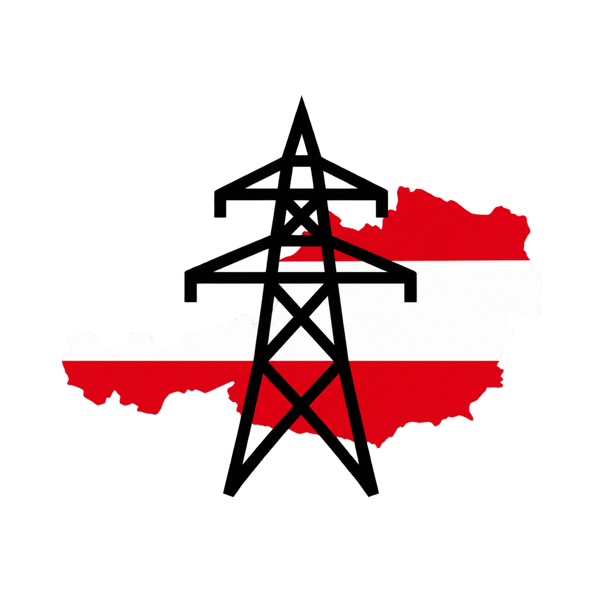

# Gridfees AUT



Home Assistant integration for Austrian variable grid fees and levies,
expressed in EUR/kWh excluding VAT.

## Status: 0.3.0

Configure a grid area, supply type, and applicable tax and SNAP settings. Multiple
different profiles can be configured; identical profiles are rejected. To change a
profile in this version, remove it and create a new one.

The default profile and device name follows this pattern:

```text
gridfees Steiermark Regular grid supply
```

Grid areas use the German names from the ordinance. Interface instructions remain
English; official German names for Entgelte, Steuern, and Abgaben are retained.

## Sensors

Each profile registers six price sensors and one binary sensor:

| Entity | Unit | Enabled by default |
| --- | --- | --- |
| Total grid fees | EUR/kWh | Yes |
| Netznutzungsentgelt | EUR/kWh | No |
| Netzverlustentgelt | EUR/kWh | No |
| Elektrizitätsabgabe | EUR/kWh | No |
| Erneuerbaren-Förderbeitrag (Netznutzungsentgelt) | EUR/kWh | No |
| Erneuerbaren-Förderbeitrag (Netzverlustentgelt) | EUR/kWh | No |
| SNAP active | On/off | Yes |

The five detail sensors are registered as disabled entities. Enable only the
ones you need in **Settings → Devices & services → Entities**, including disabled
entities in the filter. Disabled entities do not publish state updates or create
new Recorder history/statistics. Their components remain included in Total grid fees.

Price sensors use measurement statistics. They represent unit prices, not
accumulated costs. The total is the sum of the five fee and levy components.

## Tax assumptions

- The household switch selects the applicable household rate for
  **Elektrizitätsabgabe**. It does **not** indicate exemption.
- **EEG exemption from Elektrizitätsabgabe is off by default.** Enable it only when
  its conditions are met. Without it, the applicable Elektrizitätsabgabe is charged.
- This exemption is separate from the EEG reduction of Netznutzungsentgelt and
  the EEG exemption from Erneuerbaren-Förderbeitrag.
- Kleinwalsertal is treated separately for Elektrizitätsabgabe.

Existing saved tax assumptions are retained when upgrading. The new off-by-default
setting applies to newly created profiles.

## Supported tariffs

- 14 Austrian grid tariff areas: Burgenland, Kärnten, Klagenfurt, Niederösterreich,
  Oberösterreich, Linz, Salzburg, Steiermark, Graz, Tirol, Innsbruck, Vorarlberg,
  Wien, and Kleinwalsertal.
- Netzebene 7, non-metered capacity, single tariff.
- Regular grid supply and allocated local or regional EEG energy.
- Supported dates: **January 1, 2022 through December 31, 2026**.
- Tariff boundaries evaluated in `Europe/Vienna`, independently of the system's
  configured timezone.

Prices are calculated when a profile loads and refreshed at each UTC hour
boundary. This covers Vienna midnight, seasonal tariff changes, and the 10:00 and
16:00 SNAP boundaries. Unchanged snapshots do not trigger unnecessary entity
updates. The refresh timer is removed when a profile unloads.

SNAP (Sommer-Nieder-Arbeitspreis) applies to eligible regular grid supply during
the configured 2026 summer window. Published reduced Netznutzungsentgelt rates
are used directly. EEG profiles receive their applicable Netznutzungsentgelt
reduction instead; SNAP is not added. EEG reductions use commercial rounding to
two decimals in cents before conversion to EUR/kWh.

EEG profiles apply only to allocated community energy. Create a separate regular
grid supply profile for residual supply; joining an EEG does not make all energy
eligible for EEG rates.

The scope excludes the energy purchase price, VAT, fixed Grund-/Leistungspreise,
Entgelte für Messleistungen, local levies, biomass subsidies, and
Erneuerbaren-Förderpauschale. Hypothetical winter tariff scenarios are outside
the regular model.

**No extrapolation:** all price sensors and SNAP status become unavailable outside
the supported date range. Updated tariff data must be supplied in a new integration
version before 2027. The `tariff_valid_until` attribute is an exclusive boundary.

## Installation and verification

1. Copy the entire `custom_components/gridfees_aut` folder into the Home Assistant
   configuration directory. The resulting path must be
   `<config>/custom_components/gridfees_aut/manifest.json`.
2. Include `brand/icon.png` and `translations/en.json` in their respective subfolders.
3. Restart Home Assistant and reload the browser page.
4. Open **Settings → Devices & services → Add integration** and search for
   **Gridfees AUT**.
5. Select a grid area and supply type, then confirm the tariff assumptions.
6. Open the profile and verify Total grid fees and SNAP active. The five detail
   sensors are available as disabled entities and can be enabled individually.
7. For a Burgenland regular household profile, the 2026 total outside SNAP hours
   is **0.09180 EUR/kWh**; during eligible SNAP hours it is **0.07490 EUR/kWh**.
   Enable the five detail sensors if you want to inspect the sum.

The files must be installed on the Home Assistant system. When working through
Home Assistant Cloud, use an available file editor with upload support or
Studio Code Server to transfer them.

The integration icon is packaged in `brand/icon.png`. Home Assistant 2026.3 or
newer supports these local brand images. No extra image configuration is needed.

### Updating from 0.2.x

Replace the integration files, including subfolders, and restart Home Assistant.
Existing profiles receive the new official component names and generated device
names. Generated profile titles from older versions are updated; custom titles
and user-assigned device names are preserved. Entity unique IDs and existing
entity IDs remain stable, so existing references continue to work.

Home Assistant preserves the enabled/disabled state of entities that are already
registered. **If your five detail sensors were created enabled in 0.2.x, disable
those you do not need once in the entity settings.** The new defaults apply when
entities are first registered. Previously recorded history is not deleted.

Previously saved tax assumptions are also retained. To use a different exemption
setting, recreate the profile with the intended selection.

The repository includes initial HACS metadata. HACS distribution requires a
public repository; this project is not currently listed in the HACS default catalog.

## Legal sources and tariff data

See [Legal sources](docs/legal_sources.md) for all dated links and the provisions
used for the dataset:

- **Systemnutzungsentgelte-Verordnung 2018 (SNE-V 2018)**, §§ 2, 5, and 6;
  all relevant consolidated versions from 2022 through April 2026.
- **Erneuerbaren-Förderbeitragsverordnung 2025**, BGBl. II Nr. 419/2024,
  and **Erneuerbaren-Förderbeitragsverordnung 2026**, BGBl. II Nr. 301/2025,
  § 2 Abs. 2 and 3, Netzebene 7 bb.
- **Elektrizitätsabgabegesetz (ElAbgG)**, §§ 1, 2, 4, and 7, including
  Kleinwalsertal, EEG exemptions, and the 2026 household rate in § 7 Abs. 16.
- **Erneuerbaren-Ausbau-Gesetz (EAG)**, § 75 Abs. 5.

`custom_components/gridfees_aut/tariffs.json` contains the dated rates, EEG
factors, and SNAP windows. Netznutzungsentgelt and Netzverlustentgelt are stored
in cents/kWh; Elektrizitätsabgabe and Erneuerbaren-Förderbeitrag components are
stored in EUR/kWh. Decimal strings preserve published precision.

For updates, add the new dated rates, check all applicable tax and support rules,
and extend the dataset's exclusive `valid_until` boundary only when the required
rates are available. Update the regression fixtures and integration version too.

## Development and checks

Run the offline tests from the repository root:

```sh
python -m unittest discover -s tests -v
```

Tests cover the 84 region/period tariff records across all three supply types,
explicit reference prices, tariff and tax boundaries, SNAP, EEG, rounding,
Kleinwalsertal, timezone conversion, unsupported years, invalid inputs, standard
non-exempt EEG profiles, and generated profile names.

The calculation engine also provides interval-start time series over a chosen
range. It steps in UTC, producing 92, 96, or 100 quarter-hour values per Vienna
day as appropriate. A Home Assistant action for requesting these series is not
yet exposed; the entities currently show the price applicable now.

Python syntax, JSON files, and interface text are checked locally. Runtime
verification of this version's entity setup and reload in Home Assistant remains
pending.

References: [Config flow](https://developers.home-assistant.io/docs/core/integration/config_flow/),
[Sensor entities](https://developers.home-assistant.io/docs/core/entity/sensor/),
[Disabled entities](https://developers.home-assistant.io/docs/entity_registry_disabled_by/),
and [Brand images](https://developers.home-assistant.io/docs/core/integration/brand_images/).
